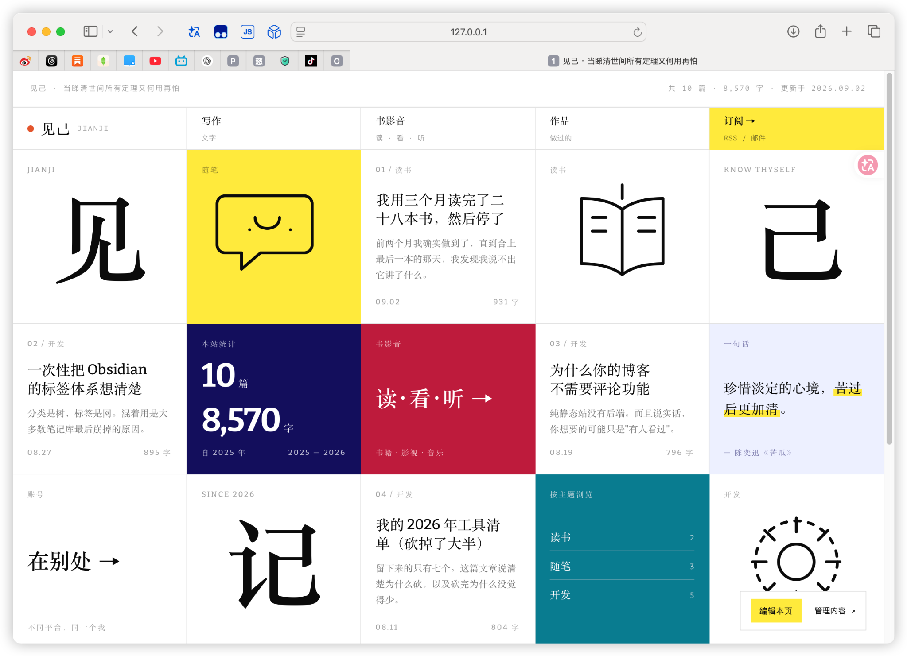
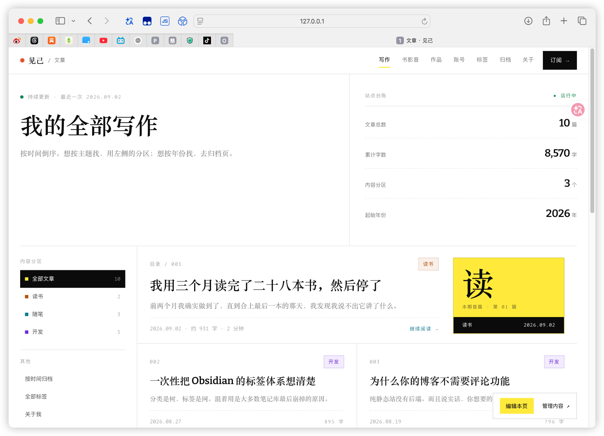
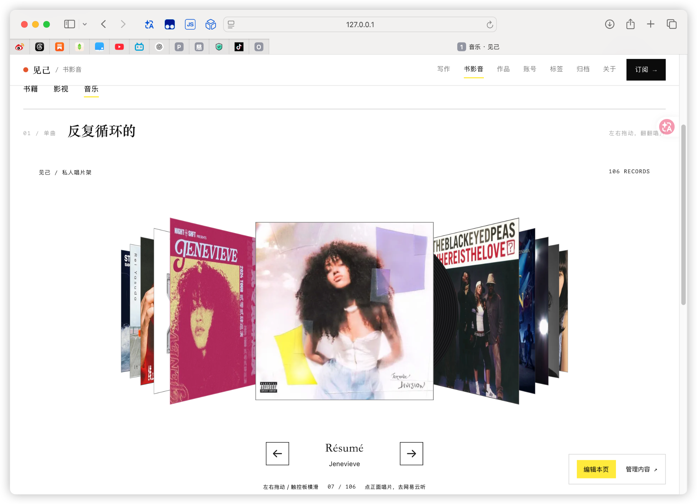

> 整理自当天「记录Vibe Coding过程」对话中的个人口述与三张原始截图。正文保留第一人称；功能进度和工具感受以我的当时描述为准，截图说明只记录可见内容。本日志未对网站功能进行独立测试。

## 为什么想做这个网站

我希望个人网站能够集中记录我在各个平台的账号、我的写作、我的书影音，以及我的一些作品。

相当于别人打开这个网站，不用先和我交谈，就能对我有一定的了解。大概了解我这个人的 30% 吧。

现在还在做 Demo，但它已经开始把这些内容放到一起了。

## Demo 目前的功能

我在当天最初记录时，Demo 已经有了这些功能：

- 文章板块。
- 音乐板块。
- 归档功能。
- 标签功能。

当天后续又补上了目前需要的内容板块，以及可以自己修改网页文字的功能。新增板块的具体清单没有在口述中逐项列出。

## 今天最喜欢的功能：翻唱片

今天做了一个我非常喜欢的功能，就是音乐独立板块里的「翻唱片」。按我当时的使用感受，它的交互非常流畅丝滑，UI 也很好看，我很喜欢这一板块的设计。

### 从书架式抽取，到横向翻唱片

一开始，我想做一个像书架一样的设计，把唱片从里面抽出来。但我觉得这个效果有点难做，也一直在想：怎么才能既清晰，又好看？

后来就改成了横向翻唱片。我觉得这样更清晰明了，也非常极简。

| 设计阶段 | 想法与判断 |
| --- | --- |
| 最初方案 | 像从书架里抽出唱片一样浏览唱片。 |
| 当时的顾虑 | 感觉实现有难度，也不确定怎样兼顾清晰与美观。 |
| 最终选择 | 改成横向翻唱片，更符合我想要的清晰、极简的感觉。 |

这次没有继续坚持最初的书架式方案，而是选了一个让我更满意的呈现方式。

## Workbuddy 和 Codex 的使用体验

之前我是用 Workbuddy 开发的，体验很不好。光是做唱片这样的东西，就觉得非常难，做出来的 UI 也很丑。

后来我找了一个模板给 Codex 看，它一下子就做出了让我满意的效果。我当时的感觉是：很好，很方便，也没有浪费我的额度，不需要我再花很多精力反复修改。

一直改、一直改，真的会让人觉得很愤怒、很烦。这次能够比较快地得到自己想要的效果，开发过程就舒服了很多。

这里记的是我在这次唱片功能开发中的个人体验。给 Codex 提供参考模板也是这次过程的一部分；没有做相同条件下的工具对比，也没有统计实际额度消耗。

## 后续补充：新增板块与可编辑文字

今天后面又把自己目前需要的内容板块都加上去了，还加了一个可以自己修改网页文字内容的功能。

能自己调整文字，感觉非常好，也很方便。

> 当天口述确认的是「能够修改网页文字内容」。编辑方式、保存机制和权限设置没有展开记录；截图能看到「编辑本页」「管理内容」入口，但不能仅凭入口判断完整编辑流程。

## 当天的三张截图

以下保留原始截图，作为这一天的 Demo 视觉记录。截图中的文章日期、内容数量和状态文字均属于页面当时的显示，不代表本次整理核验过的数据，也不作为网站上线或功能通过测试的证明。

### 1. 首页

首页采用网格卡片布局，白底、黑字和细分隔线之间，穿插黄色、深蓝、红色、蓝绿色等色块。截图中能看到写作、书影音、作品、账号、订阅等内容或入口，也能看到文章卡片、站点统计和按主题浏览的区域。

### 2. 写作页

写作页标题为「我的全部写作」。左侧展示读书、随笔、开发等内容分区，右侧和下方展示站点统计及文章列表。页面显示文章总数为 10 篇、累计字数为 8,570 字、内容分区为 3 个。

### 3. 音乐页：私人唱片架

音乐页呈现横向排列、带透视层次的唱片封面，中央唱片正面突出，两侧唱片向后延伸。截图中显示「106 RECORDS」和「07 / 106」，中央为 Jenevieve 的《Résumé》。页面还显示左右箭头，以及拖动、触控板横滑和点击正面唱片去网易云听的提示。

这些文字与控件记录了当时的界面设计；交互流畅的评价来自我的口述，截图本身不能证明拖动、切换或外部跳转实际可用。

## 阶段总结

今天最满意的是音乐板块的横向翻唱片。从最初想做书架式抽取，到后来改成横向浏览，最后得到了自己觉得清晰、极简、好看的效果。

工具体验也很直接地影响了我的心情。之前反复修改会让我愤怒、烦躁；这次给 Codex 看了参考模板后，比较快地得到了满意的结果，少花了很多来回修改的精力。

当天的进度可以记为：

- 做出了自己喜欢的横向翻唱片效果。
- 补上了目前需要的内容板块。
- 增加了自己修改网页文字内容的功能。
- 留下首页、写作页和音乐页三张阶段截图。

这一天结束时，我对目前的效果很满意，感觉很好、很方便。今天就先到这里。

下一阶段的具体开发目标，当天没有确定。
