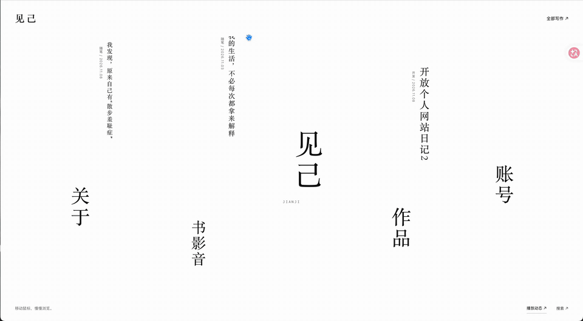
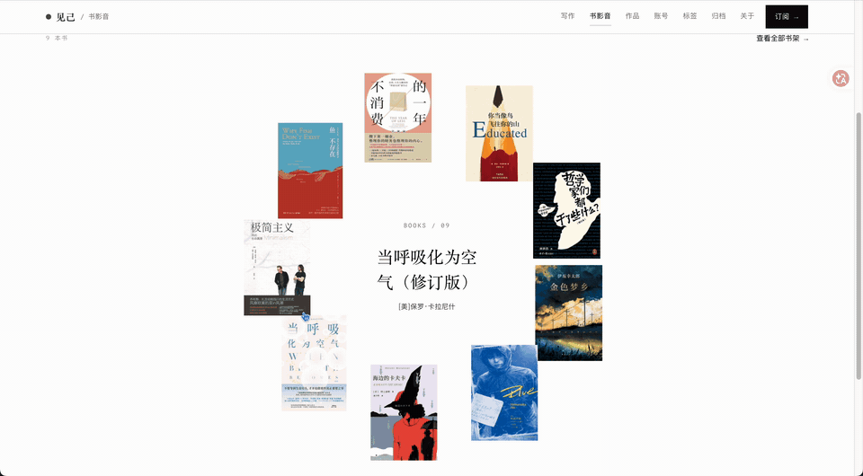

## 今日开发重点

今天主要围绕网站的视觉设计继续做调整和尝试，重点是从外部设计参考中提取灵感，再结合自己网站的内容结构做适配。

## 01｜从设计网站获取灵感

今天看了几个设计参考网站。在一个网页整体设计的网站里，看到了一个 **3D 立体房间式的图片展示**，第一反应就是觉得这个设计非常好，所以想模仿一下。

但真正代入到自己的网页之后，发现这种形式并不完全适合。

因为我自己的网页里，**文字内容比图片内容更多**，不像那个参考案例一样，主要是用图片来做展示。如果直接照搬那种“房间式”的 3D 凹面结构，可能会让内容显得不够合适，也不够清晰。

## 02｜从“模仿”到“适配”

最终的判断是：

可以保留 **3D 的空间感**，但不要直接做成那种像房间一样的 3D 凹面结构。

于是，我把这个灵感转成了另一种更适合自己网站的形式——做了一个 **会随鼠标变化、带有前后深浅层次感的文字效果**。

这个过程里，一开始做的是 **横排**，后来又改成了 **竖排**。

改成竖排之后，感觉整体效果更精致，也更有意思。相比横排，它更有设计感一些。

**开发效果录屏｜随鼠标变化的 3D 竖排文字**

## 03｜书籍页面动画调整

之后又继续做了一个 **书籍页面的动画**。

这次做成了 **圆盘旋转** 的样式，同时把原本的书架挪到了另一个页面中，这样就可以展示更多的书。

我觉得这个设计是非常好的。

它不仅让展示形式变得更有趣，也解决了原本展示容量可能不够的问题。

**开发效果录屏｜书籍圆盘与书架页面**

## 04｜开发过程中的调整

这次开发过程中依然有不断修改。

因为很多时候，不可能一句“按照这个样例来”就能直接得到一模一样、而且完全满意的效果。也不可能第一次做出来就已经非常好看。

所以中间还是改了很多。

不过整体来说，这次修改的效率还是挺高的，很多细节虽然反复调整了，但完成速度仍然比较快。

## 05｜关于 3D 效果与额度消耗

这次还有一个很明显的感受，就是：

**3D 效果虽然好看，但确实非常消耗额度。**

做这类内容的时候，额度消耗得会明显更快。

不过现在的情况还可以，因为新的额度快到了，而且每周额度明天就会刷新，所以整体心态还算轻松。

今天就先做到这里，等额度刷新之后再继续往下做。

## 06｜今日阶段总结

今天最重要的收获，不只是做出了新的页面效果，而是进一步明确了一个很重要的开发思路：

**参考可以模仿，但最终还是要适配自己的内容。**

一个在别的网站上很好看的设计，不一定原样搬到自己的网站就成立。关键在于提取出其中最适合自己的部分，再重新转化成符合自己内容结构的表达方式。

这次从“3D 立体房间”的灵感，转到“可随鼠标变化的 3D 文字层次效果”，就是一次比较清楚的适配过程。

## 07｜接下来的任务

等额度刷新之后，下一步准备继续做这些内容：

1. 再设计一下主页的细节；
2. 再排一下写作页面的文章排版；
3. 做一下影视页面的动画效果。

## 08｜今日状态

今天开发先记录到这里。

整体来说，今天的推进重点在于：

- 从设计网站获取灵感；
- 将外部参考转化成更适合自己网站的 3D 表达；
- 完成书籍页面动画的新方案；
- 明确下一轮迭代任务。

---

*影像档案：两段 2026 年 11 月 10 日开发录屏转换为 GIF，用于展示当时的网站效果。GIF 不含原录屏音频。*
