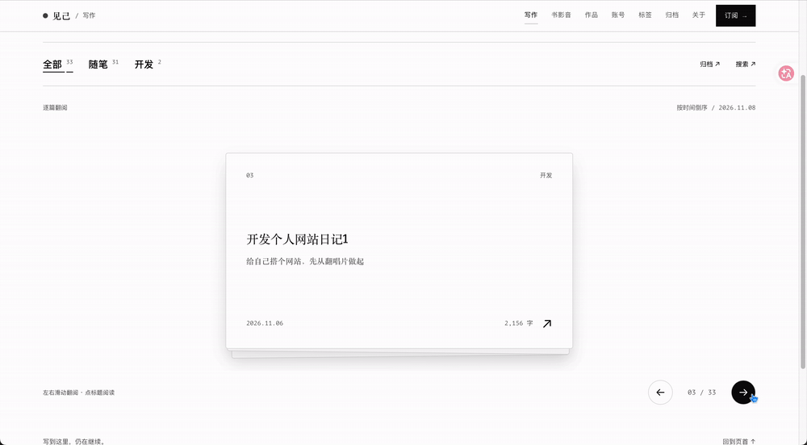

> 今日重点：完成首页名称居中调整，重新设计写作页面的文章浏览交互，并探索了用实物演示向 AI 传达设计需求的方法。

## 01｜首页 UI 的收尾调整

今天先完成了昨天还没改完的首页 UI，把首页中间的网站名称调整到了居中位置。

这次改动不大，主要是继续打磨已经搭建好的页面布局。

## 02｜写作页面：卡片翻页交互

今天最主要的任务是修改写作页面。

我把文章的展示方式改成了类似**卡片翻页**的交互。以前看长文列表，总觉得信息量比较重。这次想让浏览文章的过程轻松一些，所以先把文章呈现成一张张卡片。

文章本身仍然是长文，但访客在列表中看到的是更简洁的卡片，等到点击进入后才阅读完整内容。这样既可以保留原来的写作内容，也增加了一点浏览时的趣味性。

### 实际交互录屏

下面的 GIF 由 2026 年 11 月 11 日的网页录屏转换而来，记录了写作页面的卡片切换和叠层翻页效果。

## 03｜如何让 AI 理解一个找不到参考的动画

这次比较有意思的是，网上一直找不到我想要的那个动画效果。

最后，我干脆自己找实物演示了一遍，拍成视频发给 AI 看。这样 AI 很快就理解了我的意思。

我觉得这是一个以后还可以继续使用的方法：如果网上找不到合适的设计参考，可以通过**真实场景和实物动作**，直接把想要的交互过程演示给 AI。

以前比较依赖文字描述和参考网站。这次发现，自己拍一个动作给 AI 看，也能帮它更快理解需求。

### 本次经验

**当语言描述和现有网页案例都不够准确时，可以用实物演示来表达交互设计。**

需要保留的一点是：这一回的方式确实有效，但不同工具和不同类型的动作，理解效果可能会不同，之后仍要结合实际结果判断。

## 04｜今日完成情况

- 完成首页中间网站名称的居中调整。
- 调整写作页面，加入卡片式文章浏览交互。
- 用实物视频向 AI 演示理想的翻页动作，并完成相应的页面效果。
- 保存写作页面的实际录屏，转成 GIF 作为这一阶段的视觉记录。

## 05｜明日计划（11 月 12 日）

1. 设计影视页面的 UI 动画。
2. 整体检查个人网站，找出视觉上还不满意的地方。
3. 继续调整不顺眼的细节，让各页面的风格更加统一。

## 06｜阶段性反思

最近开发个人网站时，我越来越能感觉到，**把自己的想法表达清楚**会直接影响和 AI 合作的效率。

最开始可能只是告诉 AI「想要这种感觉」，后来学会找具体的参考图和设计案例。到今天，当网上找不到想要的效果时，我还可以自己拍一个实物演示。

这次真正让我满意的是，我能用一种更直接的方法，把脑子里的交互想法传达出去。

---

**记录说明：** 文中的 GIF 展示了开发后的网页交互效果。用于向 AI 表达想法的实物演示视频没有包含在本次附件中。
