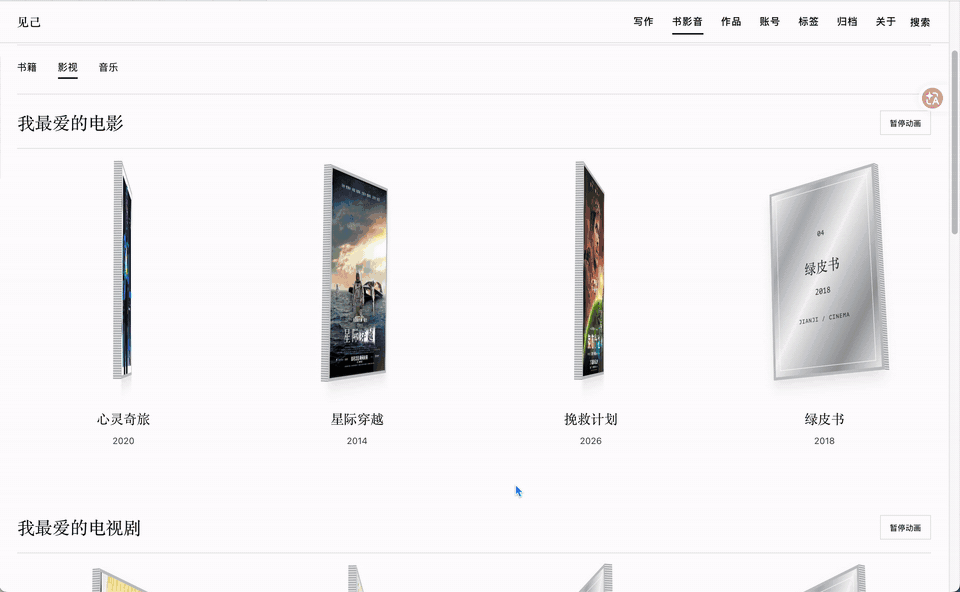

> 今日关键词：影视海报旋转、页面做减法、朋友的反馈、下一阶段的改进方向

## 01｜今天做了什么

今天其实主要就做了一件事：把**影视页面的 UI** 重新设计了一下。

另外，我还删掉了页面上一些不需要的文字，让整体看起来更加简洁。今天也把网站分享给了两个朋友，其中一位朋友给了我很多很中肯、很有用的建议。

## 02｜影视页面：从斜向滑动到硬币式旋转

一开始，我想要的是一种**斜着向上推动电影海报**的交互。想象中，电影海报像一列斜着悬空的卡片。往右上角划一下，就滑过去一页，海报再转过来。

后来 AI 在这个想法上做了一些改良。我发现现在的版本反而更有意思。

现在每一张电影海报都待在自己的位置上，能够独立旋转、翻面。它的感觉有点像**一枚方形硬币在地上旋转**，很有立体感。我挺喜欢这个结果。

这次的设计变化可以记成：

**斜向悬空排列、向右上滑动翻页 → 固定位置、独立旋转翻面的方形海报**

有意思的是，最初的交互并没有被原样实现，但 AI 提出的修改让我看到了另一种可能，最后的效果也更符合我的喜好。

### 影视页面交互效果（11 月 21 日补充录屏）

下面是实际网页的录屏动图。可以看到电影、番剧与电视剧等分区中的海报陈列，以及海报围绕竖直方向旋转、翻面时的立体视觉效果。视频摄于 **2026 年 11 月 21 日**，作为本篇 **11 月 13 日开发过程** 的后续视觉补充。

> 视觉记录说明：此动图由网页实际录屏转换，记录录制当时的页面效果，并不代表 11 月 13 日当天的每处细节都与录屏一致。

## 03｜继续给页面做减法

除了影视页面，我还清理了网站里一些没有必要的文字。

最近一直在调整网站的简洁程度。今天继续删减，是希望页面里留下的东西都有自己的作用，让浏览时的视觉感受更干净。

## 04｜第一次认真收集朋友的反馈

今天把网站发给了两个朋友看。其中一位朋友提出了六条建议，我觉得都非常中肯，也确实能帮助我继续完善网站。

### 朋友的六条建议（待实施）

- [ ] **补充书影音内容与个人感受。** 比如加入我喜欢的专辑，写下为什么喜欢；书籍、电影、电视剧等内容也可以加入自己的看法。
- [ ] **适当增加色彩。** 在缺少颜色的地方加入一点色彩元素，避免整站过于单调。
- [ ] **增强页面对比度。** 让文字和其他信息更清楚、更容易辨认。
- [ ] **重做归档页面。** 尝试时间轴式布局，让归档更有顺序感。
- [ ] **增加个人生活栏目。** 开一个“碎碎念”栏目，再加一个放生活照片的栏目。
- [ ] **增加互动。** 为网站加入更多让访客参与、操作或探索的交互设计。

这些都是朋友给出的建议，目前还没有全部实施。我很愿意采纳，之后可以按实际需要慢慢安排。

## 05｜收到反馈时的感受

我今天真的很开心。

有人愿意认真看我的个人网站，还会仔细地想它哪里可以做得更好，并告诉我具体的改进方向，这让我感觉自己的创作被重视了。

更重要的是，我觉得这些评价确实有用。它们让我看到了自己做网站时可能没有注意到的地方，所以我也很愿意把这些建议真正用到后面的修改中。

## 06｜留给下一阶段的设计问题

朋友建议增加色彩，而我在 11 月 9 日刚刚决定把网站改成黑白极简风格。这两个想法不一定冲突，但需要再试试看：**主色调继续保持黑白，只在需要强调的地方加一点颜色，会不会更合适？**

还有，做更多交互之前，也可以想想哪些互动真的能帮助别人了解我。毕竟我最初做这个网站，是想让陌生人在没有和我交谈的情况下，也能了解我的一部分。

先把今天这些建议记下来，后面再慢慢验证。

## 07｜今日收尾

**今天完成：**

- 调整影视页面，采用电影海报独立旋转翻面的新交互。
- 删除部分不必要的页面文字。
- 邀请两位朋友查看网站，收到了六项具体的优化建议。

**今日状态：开发结束。**

**视觉记录：** 2026 年 11 月 21 日补充影视页面录屏，已转成 GIF 并插入第二节。
