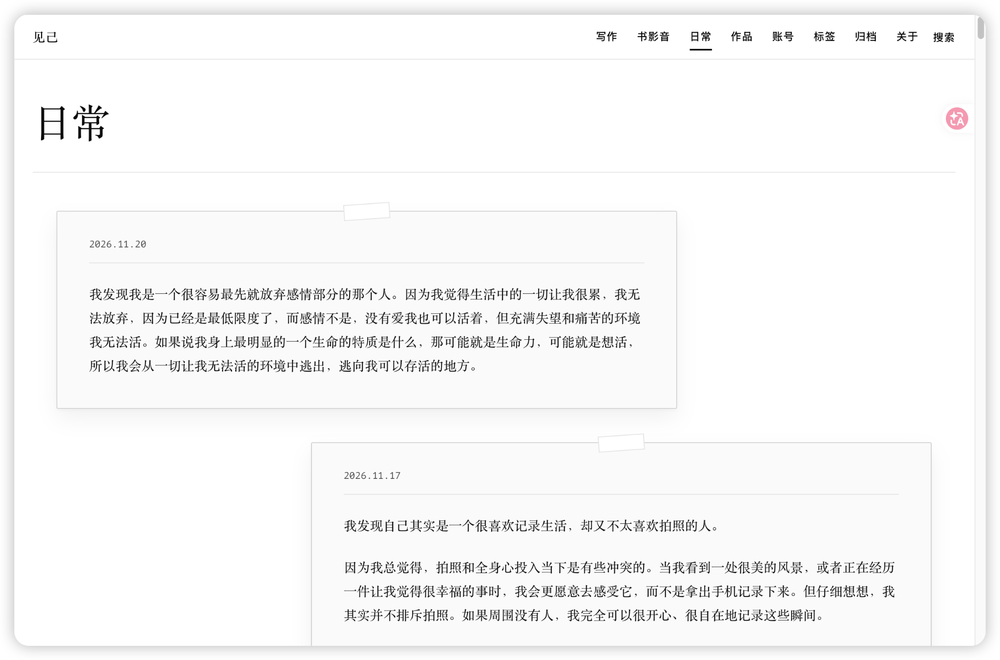
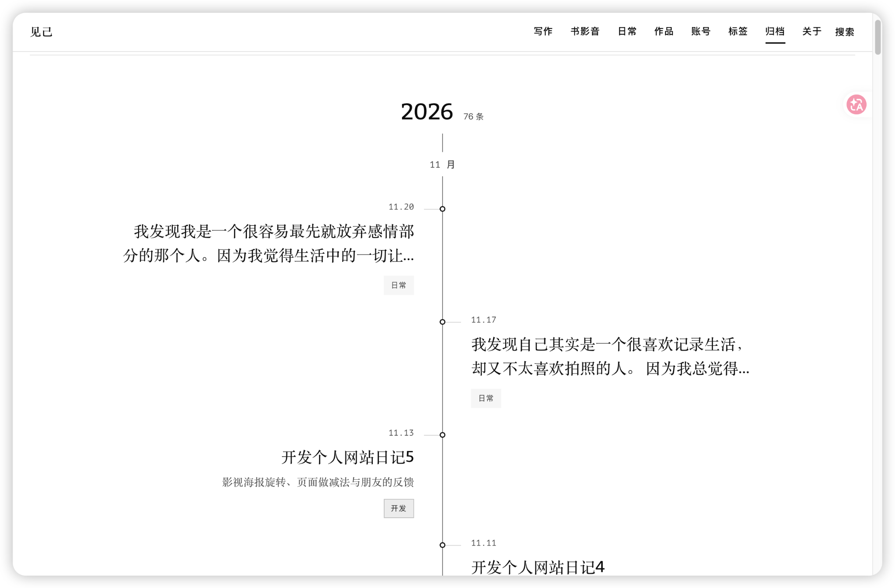

> **今日重点：** 新增音乐专辑专区、优化全站对比度、增加「日常」栏目，并将归档页面改为时间轴布局。

## 01｜音乐板块：新增专辑专区

今天在音乐板块里新增了一个专门放专辑的地方。同时，也预留了能够点评专辑、写下自己感受的位置。

这样以后除了展示我喜欢的音乐，也可以留下我对专辑的评价和听完之后的想法。目前已经为这些内容留出了位置，具体的感受可以慢慢补充。

## 02｜全站视觉：增强对比度

今天还增强了整个网站页面的对比度。我希望页面上的文字和内容能够看得更清楚，整体的视觉层次也更明确。

这也延续了之前对网站配色的调整：在以黑白和极简为主的风格下，继续通过对比度改善阅读体验。

## 03｜新增「日常」栏目

今天还新增了一个记录个人生活的栏目，名字叫「日常」。它采用了**有内容才显示**的方式，添加了内容之后才会在页面里出现。

之后，我打算慢慢把原本写过的日记搬过来，也借这个机会整理一下散落在各个平台、各个地方的生活记录和其他内容。

我希望以后这些记录能逐渐集中到个人网站里，让网站不仅展示我写过什么、看过什么、听过什么，也能留下日常生活中的自己。

### 「日常」栏目视觉记录

*补充截图摄于 2026-11-21。图中可以看到「日常」页面以类似纸张卡片的布局展示生活记录；截图内容不代表这些日记都在 11 月 18 日当天导入。*

## 04｜归档页面：改为时间轴

今天把归档页面改成了**时间轴式布局**。这个思路来自 11 月 13 日朋友给我的建议。

原来朋友建议把归档设计得更有条理一些，我这次实际做了调整。完成之后，我觉得整个页面更有设计感了，效果非常不错。

### 归档时间轴视觉记录

*补充截图摄于 2026-11-21。画面显示 2026 年 11 月的部分归档，沿中央轴线按日期分布，左右交错排列内容。*

## 05｜从朋友的建议到实际修改

11 月 13 日，我把个人网站展示给朋友，其中一位朋友很认真地提出了一些建议，包括：补充专辑和书影音感受、适当增加色彩、提高对比度、改进归档页面，以及新增关于生活的栏目。

这次开发已经开始把其中一些建议落实到网站：

- **专辑感受：** 新增专辑专区，并预留点评和感受的位置。
- **页面清晰度：** 增强全站对比度。
- **归档形式：** 采用朋友建议的时间轴布局。
- **生活记录：** 新增「日常」栏目，为以后整理日记和零散记录做准备。

其他建议后面仍然可以结合自己的审美和实际需要继续考虑。尤其是色彩的使用，我希望保持之前确定的极简方向，再决定哪里适合加入点缀。

## 06｜今日总结与后续计划

今天最满意的变化是归档页面。时间轴让页面看起来更有条理，也更有设计感。

另外，我越来越想把网站当成一个可以长期积累的地方：把喜欢的专辑、自己的感受、写过的日记和散落在不同平台上的记录，慢慢整理到一起。

**后续计划：** 逐步补充专辑评价，迁入旧日记，整理其他平台的生活记录，并继续检查网站各页面的细节。

---

**记录说明：** 本篇记录的是 2026 年 11 月 18 日的开发内容。两张界面截图于 2026 年 11 月 21 日补充，作为后来的网站视觉快照；仅根据截图记录页面外观，未独立验证实际交互功能。
