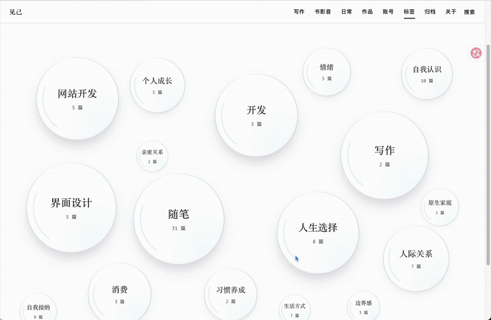

> 今天主要整理了日常、归档与标签三个页面，并将更新部署到 GitHub Pages。网站的 UI 设计逐渐接近阶段性完成，之后想把更多精力放到内容建设上。

## 01｜日常栏目：便签设计与微博迁移

今天把「日常」栏目重新做成了便签的样子，每条日常都有胶带、细边框和轻微阴影，桌面端左右交错排列。我觉得这种设计和网站整体还挺适配的，暂时先保留。

我也筛选了微博上的 **92 条记录**，排除了图片、比较简单的日常以及决定删除的内容，最终新增 **38 条文字记录**。算上原本的 2 条，现在网站共有 **40 条日常**。

## 02｜归档页面：文章和日常放进同一条时间轴

把 **36 篇文章**与 **40 条日常**合并到同一条时间轴上，总计 **76 条记录**，并按照原来的日期排列。

电脑端的内容沿中间时间线左右错落，手机端则保持单侧排列。点击时间轴中的条目，可以直接进入文章或对应的日常便签。

现在回头看，这个页面已经不仅能查看文章，也能把生活记录放在同一条时间线上了。

## 03｜标签页面：透明肥皂泡

今天重新设计了标签页面，把 **17 个分类和标签**做成了透明的肥皂泡。中间反复修改了泡泡的质感、漂浮路线、大小和位置，最后确定为比较紧凑的散落式布局，并加入前后景深、柔和阴影，以及类似首页的鼠标视差效果。

### 页面动画记录

下面这段 GIF 由 **11 月 21 日**的实际录屏转换而来，展示现在的标签页面及鼠标交互效果。

虽然现在已经做出来了，但我对泡泡的 UI 和动画还没有完全满意，还是想稍微调整一下。只是目前找不到符合想法的参考案例，所以先保留这一版，等以后找到合适的例子再改。

## 04｜上线与检查

今天调整的内容都已经发布到 **GitHub Pages**。我检查了电脑、手机和 Safari 的页面显示与操作，也保留了上一个版本，以便之后出现问题时回退。

这些检查是今天实际做过的验证，不能据此推断所有设备与浏览器都已经测试完成。

## 05｜下一阶段：从 UI 设计转向内容建设

我觉得个人网站整体的表面 UI 设计已经差不多结束了。接下来可能会少花一些时间在界面设计上，把更多精力放在内容的添加与整理上。

当然，这也不意味着以后完全不改 UI。如果以后又有新想法，或者找到了更喜欢的参考，我还是会重新设计。

网站最初就是想把我在不同地方的账号、写作、书影音、作品和生活记录放在一起。现在主要设计已经有了，接下来更重要的是慢慢把内容充实起来。

## 06｜额度使用与开发节奏

今天还发现，**五小时额度周期**大概可以成为安排开发任务的单位。

按最近的实际体验，一个额度周期通常只能做完一个主要 UI 的制作和修改，再处理少量细节。今天使用了一张五小时重置券，完成了两个 UI 的设计，整体感觉还不错。

所以我想，以后可以按照每次五小时的额度来规划网站开发：集中完成一个主要任务，剩下的额度用来处理小地方，这样也许能减少反复修改的消耗。

*注：这里的五小时指额度周期，不代表连续工作了五小时；能完成多少工作也是我目前的经验估计。*

## 07｜今日总结与待办

**今天完成：**

- 日常便签布局及微博记录筛选、迁入，日常总数达到 40 条。
- 将文章和日常合并至时间轴，共 76 条记录。
- 重新设计 17 个分类与标签的泡泡页面。
- 将改动发布到 GitHub Pages，检查电脑、手机及 Safari，并保留上一版。

**以后再做：**

- 找到合适参考后，再调整泡泡的 UI 与动画。
- 继续迁入写作、日常和兴趣内容。
- 尝试按额度周期安排主要开发任务，减少无方向的重复调整。

> 阶段性想法：网站的视觉设计可以先告一段落了。接下来，我想让它装进更多关于我自己的内容。
